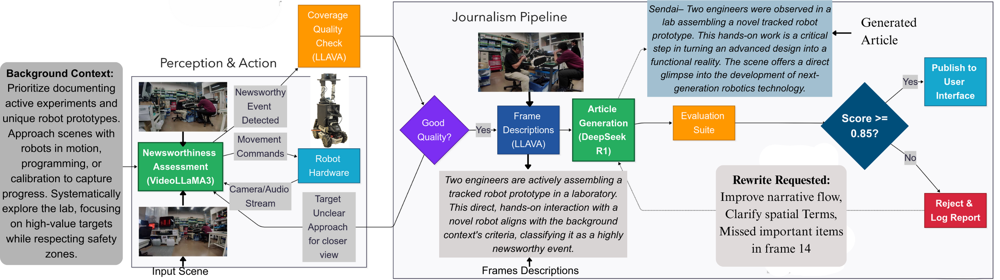
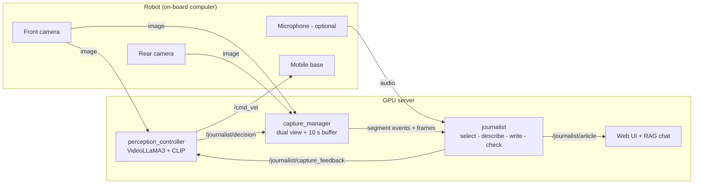

# Autonomous Robotic Journalism

**A newsworthiness-driven mobile robot for active data collection and article generation — ROS 2 implementation.**

This repository accompanies the paper

> A. Youssef, R. Bezerra, T. T. Alemayoh, S. Kojima, K. Ohno,
> *"Autonomous Robotic Journalism: A Newsworthiness-Driven System for Active Data Collection and Content Generation,"*
> IEEE/SICE International Symposium on System Integration (SII), 2027.

The robot receives a plain-text **mission brief** (what the editor wants covered). A vision-language model watches
the front camera, rates how newsworthy the current view is for that brief, and steers the robot: it scans when
nothing relevant is visible and approaches and frames a subject when one appears. When the view becomes newsworthy
enough, the robot starts recording both cameras (plus a 10-second pre-event buffer). While it records, the footage
is filtered, described and transcribed. When recording stops, a reasoning LLM writes an article draft, which an
internal checker scores and sends back for rewriting if needed.



---

## Contents

- [What is in this repository](#what-is-in-this-repository)
- [System overview](#system-overview)
- [Quick start](#quick-start)
- [Repository layout](#repository-layout)
- [Outputs](#outputs)
- [Relation to the paper](#relation-to-the-paper)
- [Limitations, safety and ethics](#limitations-safety-and-ethics)
- [Citation](#citation)
- [License and acknowledgements](#license-and-acknowledgements)

Detailed documentation lives in [`docs/`](docs/):

| Document | Contents |
|---|---|
| [installation.md](docs/installation.md) | Hardware, ROS 2, Python dependencies, model download, building, networking |
| [architecture.md](docs/architecture.md) | The two loops, data flow, threading, timing |
| [nodes_and_topics.md](docs/nodes_and_topics.md) | Every node, topic, message and parameter |
| [configuration.md](docs/configuration.md) | Tuning the controller, trigger, selection and acceptance gate |
| [mission_briefs.md](docs/mission_briefs.md) | Writing a mission brief |
| [outputs.md](docs/outputs.md) | Run folder layout and the navigation-metrics tool |
| [paper_mapping.md](docs/paper_mapping.md) | Where each equation and component of the paper is implemented |

---

## What is in this repository

Two ROS 2 packages (target platform: **ROS 2 Humble, Ubuntu 22.04, Python 3.10**):

| Package | Type | Purpose |
|---|---|---|
| `journalist_robot_interfaces` | `ament_cmake` | Message definitions: `ControlDecision`, `SegmentEvent`, `CaptureFeedback`, `Article` |
| `journalist_robot` | `ament_python` | Nodes, models, journalism pipeline, evaluation, launch files, configuration, mission briefs |

Three nodes form the system:

| Node | Role | Main models |
|---|---|---|
| `perception_controller` | Perception & action loop: velocity commands on `/cmd_vel`, newsworthiness N_t (Eq. 1), recording trigger | VideoLLaMA3-7B, CLIP ViT-B/32 |
| `capture_manager` | Combines front + rear cameras, keeps a 10 s pre-event buffer, opens and closes recording segments | – |
| `journalist` | Frame selection, multi-frame description, speech transcription, captured-view feedback, article synthesis, acceptance score (Eq. 4), rewriting, web UI with retrieval-augmented Q&A | CLIP, LLaVA-NeXT-Interleave-7B, Whisper, DeepSeek-R1-Distill-Qwen-32B, BLIP-VQA, RoBERTa-MNLI, Sentence-BERT |

## System overview



1. **Perception & action loop.** Every 2 s the controller sends the last 2 s of front-camera frames, the mission brief
   and a summary of its recent commands to VideoLLaMA3. The model returns a velocity proposal, a confidence c_t and an
   intrinsic newsworthiness rating S_news. CLIP adds mission relevance S_brief and temporal novelty S_novelty:

   N_t = 0.4·S_news + 0.4·S_brief + 0.2·S_novelty   (Eq. 1)

   A control policy clamps and gates the proposal (blocked-view reflex, turn cooldown, anti-stall exploration,
   confidence and latency speed scaling). Recording starts when N_t ≥ 0.7 and c_t ≥ 0.8 and stops when N_t < 0.3
   and c_t < 0.5 (hysteresis).
2. **Capture.** On start, the capture manager streams the buffered 10 s of combined front/rear frames, then live frames.
3. **Journalism pipeline.** CLIP drops near-duplicate frames (similarity ≥ 0.87). Batches of 8 frames are described by
   LLaVA-NeXT-Interleave together with the previous batch and the speech transcribed in that interval. The pipeline
   also checks whether the captured view is usable and on-topic and, if not, sends guidance (e.g. "rotate left toward
   the presenter") back to the controller.
4. **Article and acceptance.** When recording stops, DeepSeek-R1 writes a headline / lead / body draft from the
   time-ordered evidence. Four model-based signals give the internal acceptance score

   S = 0.35·S_fact + 0.25·S_rel + 0.20·S_cons + 0.20·S_lang   (Eq. 4)

   Drafts with S ≥ 0.85 are accepted; others are rewritten with the checker's findings, up to `max_rewrites` times.
   The result is saved, published on `/journalist/article` and shown in a local web UI that answers questions about
   the footage from the recorded evidence.

## Quick start

```bash
# 1. Build (see docs/installation.md for prerequisites and Python dependencies)
mkdir -p ~/journalist_ws/src && cd ~/journalist_ws/src
git clone <this-repository-url> autonomous_robotic_journalism
cd ~/journalist_ws
rosdep install --from-paths src --ignore-src -y
colcon build --symlink-install
source install/setup.bash

# 2. Robot side: cameras + your mobile base driver (which must subscribe to /cmd_vel)
ros2 launch journalist_robot robot_sensors.launch.py front_device:=/dev/video0 rear_device:=/dev/video2

# 3. GPU side: the whole system with one of the bundled mission briefs
ros2 launch journalist_robot journalist_system.launch.py mission:=research_lab_people_working.txt

# 4. Watch it work
ros2 topic echo /journalist/decision --field movement_label
# Articles: http://127.0.0.1:8890/   and   ~/journalist_robot_runs/<run_id>/
```

Pause and resume autonomous motion at any time (the base stops immediately on pause):

```bash
ros2 topic pub --once /journalist/autonomy_enable std_msgs/msg/Bool "{data: false}"
```

Unit tests for the model-independent parts (no GPU or ROS graph needed):

```bash
cd src/journalist_robot && python3 -m pytest test
```

A ROS 2 smoke test builds everything in the `ros:humble` Docker image and runs the controller node with a stand-in
model (motion, stale-camera stop, pause, shutdown); see [tools/ros_smoke_test](tools/ros_smoke_test/README.md):

```bash
docker run --rm -v "$PWD:/repo:ro" ros:humble bash /repo/tools/ros_smoke_test/run_in_container.sh
```

## Repository layout

```
autonomous_robotic_journalism/
├── README.md
├── LICENSE                         Apache-2.0
├── CITATION.cff
├── requirements.txt                Python (pip) dependencies for the GPU server
├── docs/                           documentation and figures
├── tools/ros_smoke_test/           Docker-based ROS 2 build and node test (no GPU)
└── src/
    ├── journalist_robot_interfaces/
    │   └── msg/                    ControlDecision, SegmentEvent, CaptureFeedback, Article
    └── journalist_robot/
        ├── config/params.yaml      all parameters, paper values marked [paper]
        ├── launch/                 journalist_system.launch.py, robot_sensors.launch.py
        ├── missions/               mission briefs (+ TEMPLATE.txt)
        ├── test/                   pytest unit tests
        └── journalist_robot/
            ├── nodes/              perception_controller, capture_manager, journalist
            ├── core/               control policy, Eq. (1), JSON parsing, prompts, mission brief, recorder
            ├── models/             VideoLLaMA3, CLIP, LLaVA-Interleave, DeepSeek-R1, Whisper, TTS wrappers
            ├── journalism/         frame selection, captured-view check, segment evidence
            ├── evaluation/         the four signals and Eq. (4)
            ├── analysis/           alignment / divergence metrics of Sec. IV-B
            └── ui/                 web UI and retrieval index
```

## Outputs

Each launch creates `~/journalist_robot_runs/<run_id>/` with every decision (input frame, prompt, raw model output,
final command, N_t components, trigger) in `decisions.jsonl`, and one `segment_XXX_HHMMSS/` folder per recording with the
selected frames, descriptions, transcript, captured-view checks, every draft with its evaluation, and the final
`article.md` / `article.json`. See [docs/outputs.md](docs/outputs.md).

The index-matched navigation metrics used in the paper can be computed from two runs:

```bash
ros2 run journalist_robot decision_metrics teleop/decisions.jsonl autonomous/decisions.jsonl --budget 70
```

## Relation to the paper

This repository is a cleaned-up ROS 2 implementation of the system described in the paper, organised as separate
nodes with all settings exposed as parameters. The pilot experiments reported in the paper were run with an earlier
research prototype of the same pipeline, so results obtained with this release are not guaranteed to reproduce the
paper's numbers exactly. [docs/paper_mapping.md](docs/paper_mapping.md) maps every equation and component of the
paper to the code.

## Limitations, safety and ethics

- **Not a safety system.** Obstacle handling relies on the VLM prompt and a lightweight image heuristic. Velocities
  are clamped, reversing is disabled by default (decisions see only the front camera), and the base is stopped when
  decisions stop arriving, when camera frames go stale, when autonomy is paused and on shutdown, but none of this is
  a certified collision-avoidance layer. Run the robot only with an independent safety layer
  (bumpers, lidar safety field, base speed limits) and a human supervisor.
- **Drafts are not verified journalism.** The acceptance score is computed by models partly reused from the
  perception pipeline; it is an internal workflow gate, not an independent factuality assessment. Generated text
  can describe things the footage does not show. Every draft needs human editorial verification before use.
- **People and privacy.** The system records audio and video of people and sends it to a GPU server. Obtain informed
  consent, follow your institution's ethics and data-protection rules, and secure the network and storage. The web UI
  binds to localhost by default and has no authentication.
- **Remote compute.** The stop commands above are sent from the GPU server. If the network link fails, no command
  reaches the base at all, so the base driver must have its own command timeout (most ROS 2 base drivers do).
  Network behaviour is not otherwise characterised.

## Citation

```bibtex
@inproceedings{youssef2027autonomous,
  title     = {Autonomous Robotic Journalism: A Newsworthiness-Driven System for Active Data Collection and Content Generation},
  author    = {Youssef, Ahmed and Bezerra, Ranulfo and Alemayoh, Tsige Tadesse and Kojima, Shotaro and Ohno, Kazunori},
  booktitle = {IEEE/SICE International Symposium on System Integration (SII)},
  year      = {2027}
}
```

## License and acknowledgements

Released under the [Apache License 2.0](LICENSE). The foundation models used here are distributed under their own
licenses (VideoLLaMA3, LLaVA-NeXT-Interleave, DeepSeek-R1-Distill-Qwen, CLIP, Whisper, BLIP, RoBERTa); check each
model card before use.

This research was performed by the commissioned research fund provided by F-REI (JPFR23010101).
Affiliations: University of Padova (A. Youssef); Tohoku University (R. Bezerra, T. T. Alemayoh, S. Kojima, K. Ohno).
Contact: ranulfo@tohoku.ac.jp
