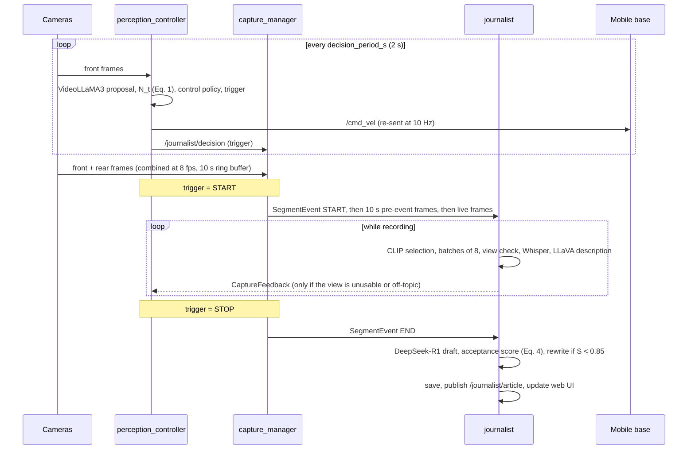

# Architecture

The system couples two loops through shared mission context and feedback:

- the **perception & action loop** decides where the robot looks and when it records;
- the **journalism pipeline** turns recorded footage into an article draft and tells the first loop when the
  captured view is not good enough.

## 1. Perception & action loop (`perception_controller`)

Per decision:

1. **Window.** Up to `frames_per_decision` frames, evenly spaced over the last `decision_window_s`, resized to
   `model_frame_width`.
2. **Image heuristics.** Edge density and entropy of the centre and sides of the view (`core/visual_heuristics.py`).
   A view whose centre has almost no edges and low entropy (e.g. a blank wall at close range) is flagged as blocked;
   forward motion then also needs the centre to look clear in 2 of the last 3 cycles. A frame-difference motion
   metric adapts the sampling temperature.
3. **Prompt** (`core/prompts.py`): system role, confidence categories, newsworthiness rubric, decision rules with the
   configured speed limits, the mission brief, the exploration state, the last five commands, the image hints and,
   if recent, the journalist's feedback.
4. **VideoLLaMA3** writes a JSON object with `linear_x`, `angular_z`, `confidence`, `newsworthiness_score` and
   `reasoning`. Generation stops at the first complete JSON object. Malformed output is parsed field by field; missing or
   non-finite values become zero and confidence / rating are clipped to [0, 1], so a garbled answer never produces a
   confident motion command.
5. **Newsworthiness N_t (Eq. 1)** from S_news (the VLM's rating), S_brief (CLIP similarity between the newest frame and
   the first paragraph of the brief, rescaled from `brief_similarity_range` to [0, 1]) and S_novelty (one minus the
   highest CLIP similarity to the last `novelty_buffer_size` views).
6. **Control policy** (`core/control_policy.py`), in order:
   - confidence < 0.2: the proposal is replaced by slow scanning; confidence < 0.3: forward speed halved;
   - blocked view or no forward consensus: forward motion suppressed, turn toward the side with more structure;
   - turn cooldown: no reversal of turn direction within `turn_cooldown_s`;
   - anti-stall: holding position is accepted only when N_t ≥ 0.7 and c_t ≥ 0.8; after three holds the robot is
     pushed forward (or to scan, if blocked);
   - confidence speed scaling (×1.0 / 0.8 / 0.6 / 0.4) and ×0.6 when inference took longer than 1.5 s;
   - clamping to `max_linear` / `max_angular`.
7. **Recording trigger** (hysteresis): START when N_t ≥ 0.7 and c_t ≥ 0.8; STOP when N_t < 0.3 and c_t < 0.5 (or
   after `max_segment_duration_s`, if set); CONTINUE otherwise.
8. **Publish** the `Twist` and a `ControlDecision`, and append everything to `decisions.jsonl`.

Between decisions the last command is re-published at `cmd_publish_rate_hz`. A zero command is published instead
if no decision has been produced for `deadman_timeout_s`, if the newest camera frame is older than `max_frame_age_s`
(camera or network stall), when autonomy is paused on `/journalist/autonomy_enable` (which also closes an open
recording segment), and on shutdown. These stops are sent from the GPU server, so the base also needs its own command
timeout in case the network link fails.

### From mission brief to search behaviour

The brief is not compiled into goals or waypoints; it acts only through the prompt and through S_brief. When no
brief-relevant subject is visible the model typically chooses a scanning rotation; when one appears it advances and
then holds or adjusts its heading to keep it framed. Changing the brief therefore changes which views lead to
approaching rather than scanning. The brief file is re-read whenever it changes on disk, so the assignment can be
edited during a run.

## 2. Capture (`capture_manager`)

- Front frames are sampled at `capture_fps`; the most recent rear frame (if not older than `rear_max_age_s`) is
  attached on the right, labelled FRONT / REAR.
- The last `pre_event_s` seconds of combined JPEG frames are kept in a ring buffer.
- On START the node publishes `SegmentEvent.START`, the buffered frames and then live frames, all on
  `/journalist/segment_frames`, without interleaving buffered and live frames. On STOP it publishes `SegmentEvent.END`.

## 3. Journalism pipeline (`journalist`)

Two worker threads keep the ROS callbacks fast.

**Selection thread.** Each segment frame is decoded and embedded with CLIP. It is kept only if its similarity to the
last kept frame is below `similarity_threshold` (0.87) and at least `min_selection_interval_s` has passed. Kept
frames are saved and grouped in batches of `batch_size` (8).

**Description thread.** For each batch:

1. *Captured-view check.* LLaVA-Interleave is asked, with the brief, whether the last frames show the subject clearly
   and on-topic, and for a suggested action. If not, a `CaptureFeedback` message is published; the controller adds it
   to its prompts for `feedback_ttl_s`.
2. *Speech.* If audio is enabled, the audio recorded since the last batch is transcribed by Whisper in
   `asr_chunk_s` chunks, on the segment's time base.
3. *Description.* LLaVA-Interleave describes the 8 frames in time order, given the brief, the previous batch's
   description and speech, and the speech of this interval.

Because descriptions are produced while recording, only synthesis remains when recording stops.

**Article.** On END, DeepSeek-R1 receives the brief, all descriptions, the transcript and a short timeline and writes
`HEADLINE / LEAD / BODY` in inverted-pyramid order. The `<think>` trace is removed.

**Acceptance (Eq. 4).** `evaluation/` computes four signals on up to `max_key_frames` frames spread over the segment:

| Signal | Computation |
|---|---|
| Factuality S_fact | 0.6 × visual grounding (BLIP-VQA asked whether each sentence is true for its best-matching CLIP frame; sentences unrelated to every frame are skipped) + 0.4 × source adherence (RoBERTa-MNLI entailment of each sentence by the top-3 retrieved descriptions) |
| Relevance S_rel | mean over sentences of the best CLIP sentence-frame similarity, rescaled from [0.15, 0.35] |
| Consistency S_cons | LLaVA-Interleave rates semantic, temporal and spatial consistency of the article with the key frames |
| Language S_lang | mean of Sentence-BERT coherence of adjacent sentences, LanguageTool error score and four structure checks |

S ≥ `acceptance_threshold` accepts the draft. Otherwise the checker's findings are given to DeepSeek-R1 for a rewrite,
at most `max_rewrites` times. A draft still below threshold is saved and published with `accepted = false` and marked
as requiring human editing. Rewriting cannot add evidence that the footage does not contain.

**Serving.** The final draft goes to `/journalist/article`, to disk and to the web UI. The UI's question answering
retrieves the most relevant descriptions and transcript lines and asks DeepSeek-R1 to answer from them only.

## Threading and executors

| Node | Callback groups | Long-running work |
|---|---|---|
| `perception_controller` | sensors (reentrant), decision timer (exclusive), command output (exclusive) | inference in the decision timer; image callbacks and command re-publishing continue meanwhile |
| `capture_manager` | one reentrant group | none |
| `journalist` | segment events + frames (exclusive, keeps their arrival order), audio (reentrant) | selection and description threads; one lock serialises use of the LLM, and the pipeline has priority over UI questions |

On SIGINT/SIGTERM each node runs its shutdown step while ROS is still up: the controller publishes zero velocity and
closes an open segment, the capture manager publishes the END/SHUTDOWN events, and the journalist closes any open
segment and waits up to `shutdown_grace_s` for its article (the launch file extends `ros2 launch`'s kill timeout
accordingly).
